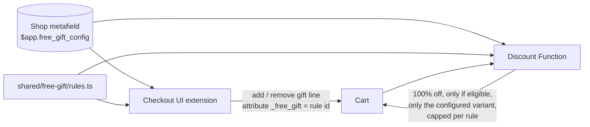

# Shopify Demos

Small, production-style Shopify demos: **Checkout UI Extensions**, **Shopify Functions**, theme app
extensions, web pixels and custom apps (API 2026-10, Preact + Polaris web components).

Every demo runs on a development store with a fictional brand and test data. Nothing here shows
real merchants, real customers or real results.

**[Try the demos on the live store](https://clark-nguyen.myshopify.com)** (store password `bfcm`):
one card per demo, each with a link that opens it ready to test. Test checkout, no real payment.
Cards live in [`theme/templates/index.json`](theme/templates/index.json); add a block there or in
the theme editor, then `node scripts/push-landing.mjs <theme id>`.

## Demos by area

| Area | Demos |
|---|---|
| Checkout | [BFCM checkout offer](#2-bfcm-checkout-offer--countdown--one-click-add-ons), [Shipping cut-off countdown + trust badges](#4-shipping-cut-off-countdown--trust-badges), [Required consent checkbox (final sale, age 18+)](#17-required-consent-checkbox-final-sale-age-18), [Order note templates](#19-order-note-templates), [Country-restricted products (no catalogs)](#20-country-restricted-products-no-catalogs), [Address autocomplete and bad-address blocking](#42-address-autocomplete-and-bad-address-blocking--what-works-on-plus-and-what-doesnt) |
| Shipping and delivery | [Free Express shipping over $120](#7-free-express-shipping-over-120--sale-items-dont-count), [Delivery rules](#11-delivery-rules--hide-rename-reorder-delivery-customization-function), [Delivery date picker + PO Box check](#12-delivery-date-picker--po-box-check), [Carbon-neutral delivery add-on](#13-carbon-neutral-delivery-add-on), [PO Box check per item, not per carrier](#27-po-box-check-per-item-not-per-carrier), [Pickup-only items](#30-pickup-only-items) |
| Discounts | [Buy 2, get 1 free](#8-buy-2-get-1-free--on-the-same-sku), [Tiered discounts](#9-tiered-discounts--volume-per-sku--spend-on-the-order), [Spend tiers that skip sale items and gift cards](#21-spend-tiers-that-skip-sale-items-and-gift-cards), [40 quantity-break tables from one discount](#22-40-quantity-break-tables-from-one-discount) |
| Gifts | [Rules-based free gift](#1-rules-based-free-gift), [Gift picker + checkout validation](#6-gift-picker--checkout-validation), [Gift for a collection + out-of-stock fallback](#10-gift-for-a-collection--out-of-stock-fallback), [Gift message + gift wrap](#18-gift-message--gift-wrap) |
| Cart rules, bundles and B2B | [Max quantity, minimum order and incompatible products](#14-max-quantity-minimum-order-and-incompatible-products), [B2B: minimum quantity, case packs, first-order minimum](#15-b2b-minimum-quantity-case-packs-first-order-minimum), [Fixed-price bundle](#16-fixed-price-bundle--cart-transform-lineexpand), [Case packs](#23-case-packs--sell-by-the-case-count-stock-by-the-bottle), [One sample kit per customer every 30 days](#28-one-sample-kit-per-customer-every-30-days), [Minimum order for wholesale-tagged customers](#29-minimum-order-for-wholesale-tagged-customers), [Native bundles with an image picker](#37-native-bundles-with-an-image-picker), [Build your own bundle](#38-build-your-own-bundle--cart-transform-linesmerge) |
| Product page and storefront | [Buy more, save more on the product page](#24-buy-more-save-more-on-the-product-page), [Shop by concern on home and collection pages](#25-shop-by-concern-on-home-and-collection-pages), [Product page pack for a Dawn theme](#35-product-page-pack-for-a-dawn-theme), [Catalog import, ingredient chart and filter](#36-catalog-import-ingredient-chart-and-filter) |
| Post-purchase and tracking | [Post-purchase: attribution survey + referral code](#3-post-purchase-attribution-survey--referral-code), [Gift funnel analytics](#5-gift-funnel-analytics--analyticspublish--a-web-pixel), [Connect GA4 with customer events](#31-connect-ga4-with-customer-events), [Affiliate ref tracking](#39-affiliate-ref-tracking--cart-attribute--web-pixel) |
| Customer accounts | [Buy again on the Orders page](#34-buy-again-on-the-orders-page) |
| Subscriptions | [Loop Subscriptions: portal and cancellation flow](#33-loop-subscriptions-portal-and-cancellation-flow) |
| Migration | [Scripts → Functions: three scripts side by side](#26-scripts--functions-three-scripts-side-by-side) |
| Custom apps | [B2B price lists in a custom app](#32-b2b-price-lists-in-a-custom-app) |

## 1. Rules-based free gift

A free gift that adds itself in checkout and **can't be abused**: the checkout extension
adds the gift line, and a discount Function independently re-checks the rules before
making it free. Every gift is shown as a product card — image, name, crossed-out price,
**FREE**, and a link to the product page — both once unlocked and as the next reward
under the "spend $X more" bar.

### ▶ Live demo

Shopify Plus development store. The first time, Shopify asks for the store password
**`bfcm`** — enter it, then click the link again to land in checkout with that cart
(test store, no real payment).

The demo store sells **Solvane**, a fictional skincare brand (14 products in 6 collections,
US + EU markets).

| Try | Cart | What you should see |
|---|---|---|
| [Not there yet](https://clark-nguyen.myshopify.com/cart/53265036247322:1) | Ceramide Barrier Cream ($38) | "Spend $37.00 more" + the travel-size cleanser you'll unlock |
| [Tier 1](https://clark-nguyen.myshopify.com/cart/53265036280090:1,53265035952410:1) | Night Cream + Gel Cleanser ($76) | Travel cleanser added free; Beauty Bag shown as the next reward |
| [Complete your routine](https://clark-nguyen.myshopify.com/cart/53265036116250:1,53265036247322:1) | Vitamin C Serum + Ceramide Cream ($86) | Serum + moisturizer → eye-patch trial pack **and** the $75 gift |
| [Tier 2 + mask branch](https://clark-nguyen.myshopify.com/cart/53265036280090:1,53265035985178:1,53265037000986:1,53265037066522:1,53265037099290:1) | 5 items incl. a clay mask ($157) | Beauty Bag replaces the travel cleanser; routine gift via "$100+ with a mask" |
| [Exclusion](https://clark-nguyen.myshopify.com/cart/53265036116250:1,53265036247322:1,53265036935450:1) | Serum + cream + full-size eye patches ($120) | No eye-patch trial (they're already buying the full size) — $75 gift only |

| Under the threshold | Tier 1 unlocked |
|---|---|
|  |  |

| Complete your routine + tier 1 | Tier 2 + routine via the mask branch |
|---|---|
|  |  |

### What it handles

| Case | Example from the demo config |
|---|---|
| Spend threshold | $75+ → Gentle Gel Cleanser travel size |
| Tiers (best one wins) | $150+ → Signature Beauty Bag *instead of* the travel cleanser |
| Nested AND / OR / NOT | ((a serum **and** a moisturizer) **or** ($100+ **and** a mask)) **and not** full-size eye patches → eye-patch trial pack |
| Per-market thresholds | $75 / **€70** and $150 / **€140** — round local amounts instead of converted ones |
| Progress | "Spend $37.00 more to unlock this free gift" + the gift's product card |
| Cart changes | Gift removed when the cart stops qualifying; extra units trimmed; duplicate lines dropped |
| Config changes | Gift for a deleted rule or an old variant is removed and replaced |
| Abuse | A `_free_gift` attribute added by hand (Cart API, theme) gets **no** discount unless the cart really qualifies |
| Multi-currency | Market overrides first; otherwise the Function converts with `presentmentCurrencyRate`. The extension only acts in currencies whose thresholds it knows |
| Checkout limits | Respects cart instructions (`canAddCartLine` / `canRemoveCartLine`), e.g. accelerated checkouts |

### How it works



- **One rules engine** (`shared/free-gift/rules.ts`) — pure TypeScript, bundled into both the
  extension and the Function's wasm, so the UI and the price can't disagree.
- **One config** in an app-owned shop metafield (`$app` namespace), readable by both halves and
  writable only by the app.
- **Extension** (`extensions/free-gift-checkout`) — plans the cart changes, applies them one at a
  time (parallel cart changes trip checkout's change throttle), and re-plans from the real `lines`
  after every update instead of blindly retrying a failed call. Gift product cards come from one
  Storefront API query per config (`api_access`).
- **Function** (`extensions/free-gift-discount`) — `cart.lines.discounts.generate.run`; the
  source of truth for price.

### Rules format

```jsonc
{
  "version": 1,
  "currencyCode": "USD",
  "rules": [
    {
      "id": "spend-75",
      "title": "Free with orders over $75",
      "giftVariantId": "gid://shopify/ProductVariant/…",
      "group": "spend", "priority": 1,          // tiers: highest priority in a group wins
      "condition": {"type": "subtotal_at_least", "amount": 75, "amounts": {"EUR": 70}}
    }
  ]
}
```

Conditions: `subtotal_at_least`, `total_quantity_at_least`, `product_in_cart` (with
`minQuantity`), and the combinators `all`, `any`, `not`. Full example:
[`scripts/demo-config.json`](scripts/demo-config.json).

### Tests

```shell
npm test
```

- **37 unit tests** for the rules engine — every case above, plus mutation-checked (breaking the
  gift-line exclusion or the variant check makes the suite fail).
- **8 Function tests** that build the wasm and run it against fixtures: eligible, attribute added
  by hand, quantity capped, wrong variant, complex rule + tier, presentment currency, per-market override, no config.
- Manually verified on a Shopify Plus dev store (screenshots above), including the abuse case.

### Run it

```shell
npm install
shopify app dev --store <your-dev-store>

# write the rules (edit scripts/demo-config.json first: variant/product ids, currency)
shopify app execute --store <store> --query-file scripts/set-config.graphql \
  --variables '{"shopId":"gid://shopify/Shop/<id>","config":"<demo-config.json as a string>"}'

# create the automatic discount backed by the Function (once per store)
shopify app execute --store <store> --query-file scripts/create-discount.graphql
```

Then in the checkout editor open **Apps → free-gift-checkout → Add block** and save. After `shopify app deploy`, re-run `create-discount.graphql` if the discount was created against a dev preview (cleaning a dev preview deletes it).

### Known limits

- In checkout the extension has no exchange rate: it acts in the config currency and in markets
  with explicit amounts (`amounts.EUR`). The Function prices correctly in every currency.
- The EU market is configured but the dev store has no EU shipping zone yet, so EUR checkouts
  aren't live; EUR behaviour is covered by unit and Function tests.
- The extension compares line totals *after* line discounts, the Function *before* — so the
  extension is the stricter of the two and never adds a gift the Function won't make free.
- "Buyer removed the gift" is remembered for the current checkout only.

## 2. BFCM checkout offer — countdown + one-click add-ons

https://github.com/user-attachments/assets/7d7917ce-b09e-4b6d-8f0a-fb9bcfd35ae5

A Black Friday block in checkout: a live countdown to the end of the campaign and
discounted add-ons the buyer adds with one click. Adding an add-on can also unlock the
free gifts from demo 1 — the two features share the same cart.

**▶ [Try it](https://clark-nguyen.myshopify.com/cart/53265036247322:1)** (store password `bfcm`) —
add the face oil, then the mask, and watch both free gifts unlock.

| Case | How |
|---|---|
| Countdown | Ticks every second to `endsAt` (exact time with offset) |
| One-click add | `applyCartLinesChange` adds the variant tagged `_bfcm_offer = <offer id>` |
| Price | A discount Function gives the offer's % off — only on the offer's variant, only up to `maxQuantity`, only between `startDate` and `endDate` in the **shop's timezone** (`shop.localTime.date`) |
| Abuse | A `_bfcm_offer` tag on another product, an unknown offer id, or a late checkout gets no discount |
| After the sale | The block disappears when the countdown ends; the Function stops discounting the next day (shop time) |

Config: [`scripts/bfcm-offer-config.json`](scripts/bfcm-offer-config.json) · logic: `shared/bfcm/offer.ts`
(14 unit tests) · Function fixtures: 5 wasm tests.

## 3. Post-purchase: attribution survey + referral code

https://github.com/user-attachments/assets/d198b4ed-9966-4d5f-b7aa-fb27226ea8a7

**"How did you hear about us?" — stored on the order, no backend.** The thank-you page can't
write to an order, so the question sits right above **Pay now**. The answer is saved to a cart
metafield, and an order metafield definition with the `cart_to_order_copyable` capability
(declared in `shopify.app.toml`) copies it onto the order — verified on test order #1001
(`$app.attribution = "instagram"`).

**Referral block on the thank-you page.** A shareable code (`FRIENDS15`, 15% off, once per
customer — created by `scripts/create-referral-code.graphql`), a copy button
(`s-clipboard-item`) and a link that applies the code automatically (`/discount/<code>`).

| Detail | How |
|---|---|
| Survey answers | Fixed list + free text for "somewhere else" (trimmed, 80 chars max) |
| Accelerated checkouts | Skipped when `canSetCartMetafields` is false |
| Reading answers | Order metafield (merchant read access); apps reading orders need protected customer data access |
| Referral config | `{code, percentOff}` in an app-owned shop metafield (`scripts/referral-config.json`) |

Logic: `shared/attribution/survey.ts`, `shared/referral/referral.ts` (12 unit tests).

## 4. Shipping cut-off countdown + trust badges

https://github.com/user-attachments/assets/65c8ce4b-3606-4a55-941c-1d1072a320d2

**"Order within 2h 41m — ships today."** Above the shipping options, computed on the
**warehouse clock** (shop timezone), not the buyer's: weekends and holidays are skipped
(Wednesday evening before Thanksgiving → "ships Friday"), and a seasonal line counts down to
the last order date ("Order by Fri, Dec 18 for Christmas delivery"). DST-safe: local wall
times are converted to UTC in two passes.

**Trust badges under the payment methods**, worded by the merchant in the checkout editor
(extension settings — no redeploy to change the copy), with sensible defaults.

| Detail | How |
|---|---|
| Cut-off config | `scripts/shipping-cutoff-config.json` (timezone, cut-off time, ship days, holidays, seasonal deadline) |
| Timezone math | `Intl.DateTimeFormat` with the warehouse IANA zone; 12 unit tests incl. DST, holidays, UTC-vs-local midnight |
| Badge copy | 4 `single_line_text_field` settings; empty → localized default |

Logic: `shared/shipping/cutoff.ts`.

## 5. Gift funnel analytics — `analytics.publish` + a web pixel

https://github.com/user-attachments/assets/74b7c141-09e2-42cc-a7e5-8e5089c7d8fd

**Which free gift actually moves the order value?** The free-gift block now tells the app's
web pixel what the buyer saw: a "spend $X more" nudge, a gift unlocked, a gift removed. The
pixel also hears `checkout_completed` and checks which gift lines were still in the order.

| Event | Sent when |
|---|---|
| `free_gift:progress_viewed` | the "spend $X more" card is shown (with the amount left) |
| `free_gift:unlocked` | a gift line is in the cart |
| `free_gift:declined` | the buyer removed a gift they qualified for |
| `checkout_completed` (standard) | the order is placed — gift lines found by their `_free_gift` property |

- **Once per checkout:** sent events are remembered in `shopify.storage`, so reloads and re-renders don't inflate the numbers.
- **No backend:** the pixel keeps running totals in the storefront's `localStorage` (`free_gift_funnel`): nudges, unlocks, keep rate and orders per gift, AOV with vs without a gift, per currency.
- **Optional collector:** set the pixel's `endpoint` to an HTTPS URL to also POST every event (GA4 proxy, Segment…); `none` keeps it local.
- **Privacy:** no personal data — rule ids, amounts and currency only.

Activate on a store: `shopify app execute --query-file scripts/activate-gift-pixel.graphql`.
Logic: `shared/analytics/gift-funnel.ts` (10 unit tests).

## 6. Gift picker + checkout validation

https://github.com/user-attachments/assets/1d46add7-a5d4-4378-b188-cac5a1e3bc96

**"Pick a free mini with orders over $120."** A rule can offer several gifts
(`giftOptions`); the buyer chooses one in checkout and can switch any time. Picker gifts are
never added automatically — the buyer's choice *is* the gift line. The discount Function
makes only an offered option free, so a variant smuggled in with the gift attribute is charged.

**A Validation Function as the safety net.** Express checkouts (Shop Pay from the cart page)
skip checkout UI extensions, so nothing removes a gift the cart no longer qualifies for. The
`gift-validation` Function runs the same rules and blocks **placing the order** when a gift line
wouldn't be free — with a message naming the gift:

| Case | Message |
|---|---|
| Cart dropped below the threshold | "Konjac Body Exfoliator is no longer a free gift for this order. Remove it to continue." |
| Variant the rule doesn't offer | "… isn't one of the gifts you can choose. Remove it to continue." |
| More units than the rule gives | "Only one … is free. Lower the quantity to continue." |

Enforced only at `CHECKOUT_COMPLETION`, so cart edits and the block's own swap steps are never
interrupted; `blockOnFailure: false` keeps checkout open if the Function itself fails.
Activate: `shopify app execute --query-file scripts/activate-gift-validation.graphql`.
Logic: `chooseGift` and `invalidGiftLines` in `shared/free-gift/rules.ts`; 5 wasm fixtures in
`extensions/gift-validation/tests/fixtures`.

## 7. Free Express shipping over $120 — sale items don't count

https://github.com/user-attachments/assets/b63773f8-7181-46b0-9f75-830c8cf45e06

A shipping rate condition ("free over $X") only sees the **cart total**. Merchants keep asking
for the threshold to ignore some items — sale items, "always ships free" products, gift
lines — and to apply to one method only. A delivery discount Function can do both:

| Cart | Sale items | Counts | Express |
|---|---|---|---|
| $142.00 | $42.00 | $100.00 | $15.00 — "Add $20.00 for free express shipping" |
| $180.00 | $42.00 | $138.00 | **FREE** — "Free Express shipping unlocked" |

- **One config** (`scripts/free-shipping-config.json`): threshold, per-market amounts (`EUR: 110`), methods (`["Express"]`, matched by title), excluded products, label.
- **Function** `free-shipping-discount` (`cart.delivery-options.discounts.generate.run`): 100% off the matching delivery options once the counted lines reach the threshold.
- **Checkout bar** (in the shipping block above the methods): same rule from `shared/shipping/free-shipping.ts`, plus "1 sale item doesn't count towards free shipping" so the buyer knows why.

Setup: `scripts/set-free-shipping-config.graphql`, then `scripts/create-free-shipping-discount.graphql`.

## 8. Buy 2, get 1 free — on the same SKU

https://github.com/user-attachments/assets/0690cba6-51bb-40f0-89ef-f1b6f6754471

**A partial-quantity line discount.** With 3 lip oils in one line, the `bogo-discount`
Function targets `{cartLine: {id, quantity: 1}}` at 100% — one unit is free, the other two
keep their price. Checkout shows it as "2 × $19.00" + "1 × FREE (Buy 2, get 1 free)" instead
of a confusing 33% off every unit. 7 in the cart → 2 free.

**The nudge.** Under each eligible line the `bogo-nudge` block shows the offer, and at 2 units
a one-tap **"Add 1 more — it's free"** (`updateCartLine`).

Gotcha: a partially discounted line reaches UI extensions **split in two** (2 paid + 1 free)
while the Function sees one line of 3. The nudge counts the SKU across lines and renders only
on the undiscounted part — otherwise it keeps asking for "1 more" after the free unit is there.

Setup: `scripts/set-bogo-config.graphql` (`scripts/bogo-config.json`), then
`scripts/create-bogo-discount.graphql`, then add the **bogo-nudge** block in the checkout editor.

## 9. Tiered discounts — volume per SKU + spend on the order

https://github.com/user-attachments/assets/a87a98b2-30ad-4248-a268-68ee8e1a6368

One config (`scripts/tiers-config.json`), one Function (`tiered-discount`) with **two discount
classes**:

| Class | Rule (Solvane demo) | Checkout block |
|---|---|---|
| PRODUCT | Gel Cleanser / Night Cream: 2+ → 5%, 4+ → 10%, 6+ → 15% (quantity summed per variant) | `volume-tiers` under the line: "Stock up & save: 2+ 5% · 4+ 10% · 6+ 15%" + "Add 1 more for 10% off" |
| ORDER | $100+ → 5%, $150+ → 10% (EUR 90 / 140); gift lines and sale items excluded via `excludedCartLineIds` | `spend-tiers` above the discount field: "Spend $2.00 more for 10% off" |

**Gotcha that broke every "spend $X more" bar.** Functions read `cost.subtotalAmount` — the
line *before* discounts. Checkout UI extensions only get `cost.totalAmount` — *after* every
discount, including the line's share of order discounts. With a 10% volume discount and a 5%
order discount applied, the bar said "Spend $18.52 more" while the Function needed $2.00.
Line discounts are listed on the line (`discountAllocations`), but a line's share of an *order*
discount is baked into `totalAmount` and listed nowhere. `shared/cart/subtotal.ts` rebuilds the
pre-discount amounts: line discounts from the line, order discounts from
`shopify.cost.subtotalAmount − Σ line totals`, handed back in proportion. The free-gift,
free-shipping and spend bars all use it, so the message matches the price.

Setup: `scripts/set-tiers-config.graphql`, `scripts/create-tiered-discount.graphql`
(`discountClasses: [PRODUCT, ORDER]`), then add **volume-tiers** and **spend-tiers** in the checkout editor.

## 10. Gift for a collection + out-of-stock fallback

https://github.com/user-attachments/assets/fd280553-5f93-4b0c-93af-1598f0483c20

**"Free mini with any Tools & Body item"** — lip oil, or eye patches once it sells out. New condition `gift_collection_in_cart`. The
discount Function can't hard-code collection ids (they differ per store), so it uses **input
query variables**:

```graphql
query CartInput($giftCollectionIds: [ID!]) { … product { inGiftCollection: inAnyCollection(ids: $giftCollectionIds) } }
```

```toml
input_variables = { namespace = "$app:free-gift", key = "input-variables" }
```

The values live in a metafield **on the Function owner** — the discount node *and* the
validation (`scripts/set-gift-collections.graphql`), mirrored from the config's
`giftCollectionIds`. The checkout block gets the same answer from the Storefront API
(`product.collections`).

**Out-of-stock fallback.** A rule can list `fallbackVariantIds`. The block reads
`availableForSale` for every gift, so a sold-out gift is replaced by the first available
fallback before anything is added; a failed add marks that variant too. The Function makes any
of the rule's variants free. Two gotchas found live:
- When a gift sells out *while it's in the cart*, Shopify removes the line itself — that's not
  the buyer declining it, so the block falls back instead of showing "You removed…".
- App metafields arrive after the first render. "Availability loaded" must be tied to the gift
  list it was loaded for, or the block adds the sold-out gift before the answer arrives and the
  buyer gets Shopify's "Out of stock" dialog.

### Week 2 recap — delivery

https://github.com/user-attachments/assets/ac3dacdd-1b8d-4e79-9881-11632cd82acd

## 11. Delivery rules — hide, rename, reorder (delivery customization Function)

https://github.com/user-attachments/assets/a873b668-87cb-4761-bc95-74085cdbe0fe

One `delivery-customization` Function (`cart.delivery-options.transform.run`) and a list of
rules in `scripts/delivery-rules-config.json`:

| Action | Option | When |
|---|---|---|
| hide | Express | cart weight ≥ 1 kg (variant `weight` × quantity, any unit) |
| rename | Standard → "Standard — USPS Ground (3–5 days)" | ships to US |
| rename | Express → "Express — UPS 2nd Day Air" | ships to US |
| move | Express to the top | US and subtotal ≥ $100 |

Rules match options by their *original* title, so a rename never stops a later rule from
matching, and a hidden option is never renamed or moved. Logic: `shared/delivery/rules.ts`.

**Two features broke each other, caught live:** the renamed "Express — UPS 2nd Day Air" no
longer matched the free-Express discount (fix: a title that *starts with* the method name
matches), and the free-shipping bar still promised free Express on a cart where Express was
hidden (fix: the bar only promises a method that's actually offered).

Setup: `scripts/set-demo-weights.graphql` (demo catalog weights), `scripts/set-delivery-rules.graphql`,
`scripts/activate-delivery-customization.graphql` (scope `write_delivery_customizations`).

## 12. Delivery date picker + PO Box check

https://github.com/user-attachments/assets/a83e6875-e539-4167-9e92-b007ed2e8900

**Pick a delivery date on the warehouse calendar.** The `delivery-date` block (below the
shipping options) uses the same calendar as the cut-off banner: earliest = ship date (cut-off
aware) + 2 delivery days, no weekends, no holidays, at most 30 days ahead
(`s-date-picker` `disallow` / `disallowDays`). The choice is a **cart attribute**, so it shows on
the order with no extra setup.

**`delivery-validation` Function** (`cart.validations.generate.run`):
- PO Box + Express (UPS can't deliver there) → an error **on the address field** while the buyer
  types (`$.cart.deliveryGroups[0].deliveryAddress.address1`). Standard (USPS) is fine.
- A stale, weekend or holiday date → blocks placing the order (`CHECKOUT_COMPLETION`).

Gotcha: Shopify Functions run in wasm without `Intl` — the shared cut-off parser used
`Intl.DateTimeFormat` to check the timezone and rejected every config inside the Function. It now
skips that check where `Intl` doesn't exist.

Setup: `scripts/set-delivery-date-config.graphql`, `scripts/activate-delivery-validation.graphql`,
then add **delivery-date** in the checkout editor.

## 13. Carbon-neutral delivery add-on

https://github.com/user-attachments/assets/5792d9cb-96ef-4d1e-abbb-f7726c3369b9

**"Make my delivery carbon-neutral (+$1.50)".** One checkbox below the shipping options adds or
removes a **service line** — its own product (no shipping, not taxable), so it is priced in the
buyer's currency, reported like any product, and visible on the order. Turning it off removes
every add-on line; the block only shows next to real products.

**Services must not unlock offers.** The first live test showed the $1.50 line moving the
"spend $X more for a free gift" bar. Gift rules now take `excludedProductIds` (like the
free-shipping and spend-tier configs already did), and the add-on is excluded from all three.

Setup: `scripts/create-carbon-offset-product.graphql` (store execute), `scripts/set-carbon-offset-config.graphql`,
then add **carbon-offset** in the checkout editor.

### Week 3 — cart rules

## 14. Max quantity, minimum order and incompatible products

https://github.com/user-attachments/assets/9a92db60-b20b-4370-8947-5797c819ff04

**One validation Function, three rule types, one JSON config** (`shared/cart/rules.ts`):
- `max_quantity` — "You can buy up to 3 of Vitamin C Brightening Serum per order (you have 4)." Split lines
  of the same product are added up first.
- `min_subtotal` — "The minimum order is 25.00 USD. Add 16.00 USD more to check out." Round
  amounts per market (`amounts: {EUR: 25}`); gift lines and services never count.
- `incompatible` — "One mask per order: Purifying Clay Mask and Charcoal Peel-Off Mask can't be ordered
  together. Remove one to continue."

The `cart-rules` Function (`cart.validations.generate.run`) skips `CART_INTERACTION`, so the cart
page stays editable, and blocks at checkout with a message that says exactly what to change.
No UI block needed — checkout shows the errors itself.

Setup: `scripts/set-cart-rules-config.graphql` (with `scripts/cart-rules-config.json`),
`scripts/activate-cart-rules.graphql`.

## 15. B2B: minimum quantity, case packs, first-order minimum

https://github.com/user-attachments/assets/1df9c0c5-f285-469c-b9bc-33b2537283b3

Same `cart-rules` Function; every rule can be scoped with `"buyer": "b2b"` (buying for a company
location) or `"retail"`:
- `min_quantity` — "The minimum for Purifying Clay Mask is 3 (you have 2)." No `productIds` =
  every product.
- `case_pack` — "Hydrogel Eye Patches ships in cases of 6. Change the quantity to 6 or 12 (you
  have 8)."
- `min_subtotal` + `firstOrderAmount` — €500 first order, €300 after, from the company location's
  order count.

Two things the live test caught:
- **The minimum uses the Subtotal the buyer sees.** Line `subtotalAmount` in the Function is
  *before* item discounts, so a "buy 2 get 1" cart showing $268 passed a $300 minimum. The
  Function now reads `cart.cost.subtotalAmount` (after item discounts) minus gift and service lines.
- **Order history counts only when signed in.** A guest who types an email gets that customer's
  `numberOfOrders` — anyone can type anyone's email — so it's used only with `isAuthenticated`.

The demo was recorded with the B2B rules applied to every buyer (a B2B login needs the buyer's
email code); `scripts/cart-rules-config.json` scopes them to company buyers.

## 16. Fixed-price bundle — Cart Transform `lineExpand`

https://github.com/user-attachments/assets/bdd332f5-62b6-499c-8838-76694fc6f89f

**"Glow Routine Set" — $99 instead of $124.** One product in the store and the cart; the
`bundle-expand` Function (`cart.transform.run`) expands it into Cleanser + Serum + Night Cream
at checkout, so each component keeps its own inventory and revenue line on the order.

- Components and their list prices live in a variant metafield (`custom.bundle_components`).
- `shared/bundle/bundle.ts` splits the bundle's own price (already in the buyer's currency) by
  list price, rounded to the cent, with leftover cents added so the parts sum exactly:
  $19.17 + $38.32 + $41.51 = $99.00 (test order #1004).
- The bundle variant has `requiresComponents: true`, so it can't be sold without the expansion.
- `lineExpand` works on every plan through an App Store app. A custom app with any Function needs
  Shopify Plus, and `lineUpdate` (price override) is Plus-only. Not on Plus? See [native bundles](#37-native-bundles-with-an-image-picker).

Good to know: validation Functions see the **bundle line**, not its components — 4 sets carry 4
serums past a "max 3 serums" rule. Count components in the rule if that matters.

Setup: `productCreate` "Glow Routine Set", `scripts/create-bundle.graphql` (store execute), then
`scripts/activate-bundle-expand.graphql` (app execute; scope `write_cart_transforms`).

## 17. Required consent checkbox (final sale, age 18+)

https://github.com/user-attachments/assets/0b709b22-9f46-4430-a1b3-7ca7219533cb

**"I understand Black Friday deals are final sale and can't be returned."** A `consent` rule in
the cart-rules config lists the products that need an explicit yes:
- The `consent-checkbox` block (`purchase.checkout.actions.render-before`, right above Pay now)
  shows the box only when one of those products is in the cart (free gift lines don't count).
- Ticking it writes the rule id to the **`Consent` cart attribute**, so the order shows
  "Consent: final-sale" under Additional details.
- The `cart-rules` Function refuses the order without it, but only at `CHECKOUT_COMPLETION`: a
  box the buyer hasn't reached yet shouldn't be an error while they type their address.

Same rule for age checks: `{"type": "consent", "id": "age-18", "label": "I'm 18 or older", …}`.
A UI-only checkbox is a suggestion; the Function makes it a requirement.

Setup: add the rule to `scripts/cart-rules-config.json`, run `scripts/set-cart-rules-config.graphql`,
then add **consent-checkbox** in the checkout editor.

## 18. Gift message + gift wrap

https://github.com/user-attachments/assets/84448f0d-cc4a-4be5-8d69-648a70976259

**"This order is a gift"** under the items in the order summary (`gift-options` block,
`purchase.checkout.cart-line-list.render-after`):
- **Card message** → the `Gift message` cart attribute (Additional details on the order), cleaned
  in `shared/gift/options.ts`: no control characters, at most one blank line, cut to 200 chars.
- **Gift wrap (+$5)** → its own product line, priced in the buyer's currency via the Storefront
  API; one wrap per order, unticking "gift" removes both.
- The wrap is in `excludedProductIds` of the gift, free-shipping, tier and cart-rules configs:
  a $5 service never unlocks a $9 gift.

Lesson from the live test: a wrap that "doesn't require shipping" becomes **its own
fulfillment** (order #1006), so the warehouse sees it apart from the items it wraps. Requiring
shipping with weight 0 keeps it in the same parcel (order #1007). (The carbon-offset add-on is a
pure service, so a separate "no shipping" line is right there.)

Setup: `productCreate` "Gift wrap", `scripts/create-gift-wrap.graphql` (store execute),
`scripts/set-gift-options-config.graphql`, then add **gift-options** in the checkout editor.

## 19. Order note templates

https://github.com/user-attachments/assets/d69d9fe4-7a5c-49dd-abbc-b4124337aa1c

**Delivery instructions in one tap.** Checkout has no order-note field of its own, so the
`order-note` block (`purchase.checkout.delivery-address.render-after`) writes the note through
`applyNoteChange`:
- Suggestions ("Leave at the door", "Call on arrival", "Reception", "No invoice in parcel") are
  whole lines: tapping adds the line, tapping again removes that line only
  (`shared/notes/templates.ts`).
- Free text the buyer typed stays put; the note is capped at 200 characters, and a suggestion
  that doesn't fit says so instead of being cut.
- The note shows under **Notes** on the order (test order #1008).

Setup: `scripts/set-order-note-config.graphql` (with `scripts/order-note-config.json`), then add
**order-note** in the checkout editor.

## 20. Country-restricted products (no catalogs)

https://github.com/user-attachments/assets/5cd03e75-9b78-4e5d-bca4-1a63b333a528

**"This mask ships to the US only."** The merchant fills a product field, **Ships to countries**
(metafield `custom.ship_to_countries`, a list of country codes). The `cart-rules` Function reads
it with the delivery country (rule `{"type": "country_restriction"}`):
- Delivery to a country not on the list → "Charcoal Peel-Off Mask can't be shipped to CA (ships to
  US only). Remove it or change the delivery address."
- Products with an empty field ship anywhere; free gift lines are never blocked.
- No market or catalog changes: the restriction travels with the product.

Setup: `scripts/setup-ship-to-countries.graphql` (store execute: definition + demo value), add the
rule to `scripts/cart-rules-config.json`, run `scripts/set-cart-rules-config.graphql`.

## 21. Spend tiers that skip sale items and gift cards

https://github.com/user-attachments/assets/acc39262-6a9c-48e1-b82f-6269acf8c098

**No discount on top of a discount.** The spend tiers from section 9 gain two switches in
`scripts/tiers-config.json`:
- `"excludeOnSale": true` — a line whose compare-at price is above its price doesn't count
  towards the tier and gets no extra %, with no product list to keep up to date.
- `"excludeGiftCards": true` — gift cards don't count and are never discounted.

Cart $118 = Serum $48 + Night Cream $52 + Exfoliator $18 (on sale, was $24) → $100 counts → 5% off
those two lines = **−$5.00**, not $5.90. The `tiered-discount` Function reads
`compareAtAmountPerQuantity` and `product.isGiftCard`; the `spend-tiers` bar gets the same flags
from the Storefront API and says "Sale items and gift cards don't count towards this discount."

Setup: `scripts/set-demo-sale-item.graphql` (store execute, demo compare-at), then
`scripts/set-tiers-config.graphql`.

## 22. 40 quantity-break tables from one discount

https://github.com/user-attachments/assets/b0802f42-b07a-45f5-a0f8-ef49d73647bd

**One automatic discount per product doesn't scale** (stores hit the automatic-discount limit
long before they run out of products). The `tiered-discount` Function now reads a list of
tables, `volumeRules`, next to the original `volume`:
- Each table: its products, its tiers, its label ("Eye patch 3-pack — 12% off",
  "Barrier duo: 2+ 8% · 3+ 12%"). First matching table wins (`volumeRuleIndex`).
- A malformed table is dropped on its own; the other tables keep working.
- The `volume-tiers` block shows each line's own ladder and "Add 1 more for 12% off".

Measured with `shopify app function run`: 40 tables × 20 cart lines = **6.8M of the 11M
instruction limit** in JavaScript (1 table × 1 line = 0.86M). For hundreds of tables, write the
Function in Rust.

Setup: add `volumeRules` to `scripts/tiers-config.json`, run `scripts/set-tiers-config.graphql`.

## 23. Case packs — sell by the case, count stock by the bottle

https://github.com/user-attachments/assets/e3fb8680-6f0d-479f-8604-0d41b75b1d62

**"Gentle Gel Cleanser — Case of 6", $125 (6 × $24 = $144).** A case is a bundle with one
component, so the `bundle-expand` cart transform from section 16 handles it:
`{"components": [{"variantId": "<bottle>", "quantity": 6, "weight": 24}]}`.

The cents problem: $125 / 6 = $20.8333…, and 6 × $20.83 = $124.98. `priceComponents` now puts
the leftover cents on one unit, split out as its own line: **5 × $20.83 + 1 × $20.85 = $125.00**
(test order #1009, both lines "Part of: Gentle Gel Cleanser — Case of 6"). Pricing the case so it
divides ($120 / 6 = $20.00) gives a single clean line.

Found in the Function logs: discount Functions see the **case line**, not the bottles. With a
compare-at price the case counts as on sale, so `excludeOnSale` keeps spend tiers from stacking on
the case discount.

Setup: `productCreate` "Gentle Gel Cleanser — Case of 6", then `scripts/create-case-pack.graphql`.

### Storefront — theme app extension

## 24. Buy more, save more on the product page

https://github.com/user-attachments/assets/36e7e588-f9e1-4ca9-a888-e97010d9076f

**Quantity options under the price, from the same config as the discount.** The block reads the
`tiers_config` metafield that the `tiered-discount` Function uses, so the storefront and the
checkout can't disagree: 4 × Gentle Gel Cleanser shows $86.40 in the block, the cart and checkout.

It doesn't add its own button. It sets the quantity on the theme's buy form, so the theme's Add to
cart and cart drawer keep working. Products with no table show nothing. Products with several
variants show the percent only, because the block prices the selected variant at page load.

Found while testing: this theme has a hidden installment form before the buy form, so the block
looks for the form that has a submit button.

Setup: theme editor → product template → Add block → Apps → **Buy more, save more**.

## 25. Shop by concern on home and collection pages

https://github.com/user-attachments/assets/8d06ac5a-f249-4b22-b8cd-4d4658c80461

**Tabs from a collection list, with quick add.** Tabs switch without a page load and follow the
ARIA tabs pattern (arrow keys, Home, End). Quick add posts to `/cart/add.js` and shows a link to the
cart. Products with several variants link to the product page instead.

Setup: theme editor → Add section → Apps → **Shop by concern**, then pick up to 3 collections.

### Migration — Shopify Scripts

## 26. Scripts → Functions: three scripts side by side

https://github.com/user-attachments/assets/5b98d906-e721-4cac-b300-78748fadf4b4

**[Read the guide](docs/scripts-to-functions.md):** three common Plus scripts next to the Function
config that replaces them: spend tiers that skip sale items, rejecting discount codes, and hiding
and renaming shipping rates.

New here: `rejectCodes` in the tiers config. With a sale item in the cart, the `tiered-discount`
Function returns `enteredDiscountCodesReject`, and the buyer sees why the code didn't work.
`allowedCodes` keeps a staff code working. Without a sale item, `WELCOME10` works as normal.

Setup: add `rejectCodes` to `scripts/tiers-config.json`, then run `scripts/set-tiers-config.graphql`.
The demo code comes from `scripts/create-demo-codes.graphql`.

### From merchant questions

## 27. PO Box check per item, not per carrier

https://github.com/user-attachments/assets/07eef043-dde3-482e-9c12-0a349903e2b5

Some items can't go to a PO Box on any delivery option. Tick the product field **No PO Box
delivery** (`custom.no_po_box`), and the `delivery-validation` Function puts the error on the
address field. In the demo, Squalane Face Oil is blocked even on Standard, while Ceramide Barrier
Cream goes to the same PO Box. The check runs per delivery group, so it only looks at items in
that shipment.

Setup: `scripts/setup-no-po-box.graphql`.

## 28. One sample kit per customer every 30 days

https://github.com/user-attachments/assets/743d2fe4-6e1a-40b6-8d4a-2780bf285440

The `once_per_period` rule in `cart-rules` reads the customer field `custom.sample_kit_last_order`.
The buyer **doesn't have to sign in**: the Function also receives that field when a guest's email
matches a customer.

| Buyer | Result |
|---|---|
| Signed in, too soon | Blocked, with the date the next kit is available |
| Guest, email matches a recent claim | Blocked, with no date (the email alone doesn't prove who is typing) |
| New email, or the period has ended | Passes |

Limits:
- A brand-new email passes, so this stops repeat buyers, not someone with many addresses.
- In the test, the Function didn't get the customer about 15 seconds after the order. It did 3 minutes later.
  Very fast repeat orders can get through that gap.
- The date has to be written when a kit is ordered. Use a Shopify Flow: **Order created** → the
  order contains the kit → update the customer metafield. This demo sets the date by hand; the
  Flow isn't set up here.

Setup: `scripts/create-sample-kit.graphql`, `scripts/setup-sample-kit-limit.graphql`, then
`scripts/set-cart-rules-config.graphql`.

## 29. Minimum order for wholesale-tagged customers

https://github.com/user-attachments/assets/1dc1507c-32a4-4ac5-b5d9-a6a6aaa4c0db

A store without B2B catalogs can still hold wholesale customers to a minimum. A `min_subtotal` rule
with `"buyer": "wholesale"` applies to customers tagged `wholesale` (`hasAnyTag` in the
`cart-rules` Function). In the demo the same $38 cart is blocked for the tagged email and passes
for anyone else; the tagged customer passes at $100.32.

A guest whose email matches the tag gets the minimum too. That is safe because the rule only
blocks. **Never use a guest's email to grant something**, like a VIP gift: the email isn't verified,
so anyone who knows it would get the gift. Check `isAuthenticated` for those.

Setup: tag the customer, add the rule to `scripts/cart-rules-config.json`, then run
`scripts/set-cart-rules-config.graphql`.

## 30. Pickup-only items

https://github.com/user-attachments/assets/0f9c05d9-80fb-489c-a0f8-b6d291faf972

Tick the product field **Pickup only** (`custom.pickup_only`). With a shipping option selected,
the `delivery-validation` Function tells the buyer to choose Pickup; with Pickup, the order goes
through. It reads `deliveryMethodType` on the selected option, so option names don't matter.

Gotcha: a pickup location needs an address. Without one, checkout says "No locations with your
items" even though pickup is on.

Setup: `scripts/setup-pickup-only.graphql`.

---

Built by **Clark (Chien) Nguyen** — Shopify app developer, Checkout Extensibility & Functions.
[Upwork](https://www.upwork.com/freelancers/~01d98f2acd2861ac4f) ·
[LinkedIn](https://www.linkedin.com/in/clark-nguyen-149413272/) ·
[dev.to](https://dev.to/chienit3bk)

Product photos: [Shopify Burst](https://www.shopify.com/stock-photos) (free for commercial use). Solvane is a fictional brand.

## 31. Connect GA4 with customer events

Send `page_view` through `purchase` to GA4 without editing the theme or checkout. Pick a
[custom pixel](docs/examples/ga4-custom-pixel.js) to paste in the admin, or the app pixel with
two settings. Setup steps, event map, consent notes and what was tested:
[`docs/ga4-pixel.md`](docs/ga4-pixel.md).

Logic: `shared/analytics/ga4.ts` (17 unit tests).


## 32. B2B price lists in a custom app

An embedded app with its own database. It gives a company location a Shopify catalog, a discount and
fixed prices for one collection. A retail price change reaches the company price through a webhook.
Test data on a fictional store. Screenshots, setup and limits:
[`apps/clark-catalog-pricing`](apps/clark-catalog-pricing/README.md). Video:
[`docs/demos/catalog-pricing.mp4`](docs/demos/catalog-pricing.mp4).

Stack: React Router, Prisma, Polaris web components, Admin GraphQL `2026-10`.

## 33. Loop Subscriptions: portal and cancellation flow

A meal-kit subscription set up in Loop on a development store, on Loop's Free plan. No custom code:
this demo is app setup and testing. Video:
[`docs/demos/loop-subscriptions.mp4`](docs/demos/loop-subscriptions.mp4).

- Plans: weekly, every 2 weeks and every 4 weeks, 10% off.
- Portal: change frequency, skip an order, swap a meal, add a discount code.
- Cancellation: each reason gets its own options, and the customer can always continue to cancel.
- Offers: `STAY15` for a customer who finds it too expensive, `WELCOME25` and `WELCOME15` for new
  subscribers. Customers enter these codes by hand.

Found while testing: a theme with custom add-to-cart JS can drop the plan. This test theme appended
an empty `selling_plan`, so the cart got a one-time item at full price. The theme's own purchase
radios worked; the Loop widget needs that append removed.

Not tested: a second billing cycle, the portal at phone width, and delay or pause.

## 34. Buy again on the Orders page

Shopify already has a Buy again button on each order. This block in customer accounts gives one
list across recent orders instead: free gift lines are dropped, a product bought twice shows once,
and each item is one click. Extension: [`extensions/buy-again`](extensions/buy-again), rule:
[`shared/customer-account/buy-again.ts`](shared/customer-account/buy-again.ts). Video:
[`docs/demos/buy-again.mp4`](docs/demos/buy-again.mp4).

https://github.com/user-attachments/assets/136a741c-a564-4c92-9888-07f23f3c7df5

- Reads the last 5 orders from the Customer Account API and shows up to 4 items, newest first.
- Each link adds the item to the current cart with the quantity from its newest order.
- Test data on a fictional store: a paid Vitamin C x2 appears, a $0 Charcoal Mask gift line does not.

Found while testing on the live store:

- The block was empty for real customers, though the editor preview looked fine. The app needs
  `customer_read_customers` and `customer_read_orders`, and after the deploy the store still has to
  approve them.
- A `/cart/<variant>:<qty>` permalink replaces the cart and opens checkout, so a second click lost
  the first item. The block uses `/cart/add` instead.

Not tested: a customer with no orders, phone width, or an item that is out of stock.

## 35. Product page pack for a Dawn theme

**Swatches, sticky add to cart, a better cart drawer, related products and custom options, with no
theme code edits.** Everything is a theme app extension: app blocks on the product template and one
app embed for the drawer. Blocks: [`extensions/storefront-blocks`](extensions/storefront-blocks).
Video: [`docs/demos/product-page-pack.mp4`](docs/demos/product-page-pack.mp4).

https://github.com/user-attachments/assets/129a388f-5ae1-44fb-afc6-80fb94afdb33

- **Variant swatches:** drive the theme's own picker, so price, URL and buy button keep working. A
  shade shows as sold out or unavailable for the size picked. Colors come from Shopify's option
  swatches, or a `Rose: #d98a94` list in the block settings.
- **Sticky add to cart:** shows on phones once the buyer scrolls past the theme's button, and
  presses that button, so the quantity and the drawer behave the same.
- **Cart drawer:** free shipping progress from the config the discount Function reads (a test
  compares both rules), plus one add-on product.
- **Related products:** Shopify recommendations with quick add. New stores get few of these, so a
  collection fills the gap.
- **Custom options:** a text field with a character limit, a dropdown and a checkbox, saved as line
  item properties. Required options block Add to cart and Buy it now. An option can depend on
  another one.
- **Paid add-on:** unticked by default, with its price on the label. It is a real product on its own
  cart line, so nothing is hidden in another price. Buy it now hides while it's ticked, because that
  button can't add a second line.

A merchant sets options without code: **Content → Metaobjects → Product option**, then picks them on
the product. The definitions ship with the app in `shopify.app.toml`.

Test data on a fictional store: Nourishing Lip Oil in 4 shades and 2 sizes. Coral 8 ml is sold out
and Berry 15 ml doesn't exist. Test order #1015 kept `Occasion`, `Add a personal label` and
`Name on label` on the order line, with gift wrap as its own $5 line.

Found while testing on the live store:

- `form.id` returned the form's `<input name="id">`, not its id, so the fields weren't attached to
  the form. `getAttribute('id')` fixed it.
- Clearing an error on `change` moved the layout between mouse down and up, so the next click
  missed. Errors now clear on `input`.
- A first add into an empty cart showed a blank drawer, because the theme's own submit is what
  removes `is-empty`.

Limits: quick add on other pages skips option checks, so a product with required options should
have several variants or no quick add. `cart-pack.js` is 14 KB, over the 10 KB theme check limit.
Not tested: Shopify's own option swatches, or themes other than this Dawn-based one.

Setup: `scripts/setup-lip-oil-shades.graphql`, `scripts/create-lip-oil-variants.graphql`,
`scripts/setup-product-options.graphql`, `scripts/set-product-options.graphql`, then add the blocks in
the theme editor and turn on **Cart drawer boost** under App embeds.

## 36. Catalog import, ingredient chart and filter

**A CSV becomes products with metafields, a metaobject chart and working filters.** The script checks
the whole file first and reports every bad row with its line number. One bad row stops the import,
so a file never lands half applied. Script: [`scripts/import-catalog.mjs`](scripts/import-catalog.mjs),
logic and tests: [`shared/catalog`](shared/catalog), blocks: [`extensions/storefront-blocks`](extensions/storefront-blocks).
Video: [`docs/demos/catalog-filter.mp4`](docs/demos/catalog-filter.mp4).

https://github.com/user-attachments/assets/8f69bdfd-1be2-4d9e-8748-388f568159d1

- **Column mapping:** [`scripts/catalog-map.json`](scripts/catalog-map.json) links your CSV headings to fields, in any column order.
- **Dry run:** `node scripts/import-catalog.mjs scripts/catalog-demo.csv --dry-run` writes nothing. It checks
  price, handle, duplicates, allowed regions and concerns, the ingredient format and the image URL.
  Try [`scripts/catalog-demo-bad.csv`](scripts/catalog-demo-bad.csv).
- **Safe by default:** handles must start with `demo-import-`, so an import can't overwrite another product.
  Running it again updates the same products.
- **Metafields + metaobject:** `custom.region`, `custom.concerns` and `custom.ingredient_chart`, which
  points to an `ingredient_chart` metaobject set per product. The **Ingredient chart** block shows it.
- **Filter:** the **Collection filter** block uses tag URLs such as
  `/collections/catalog-demo/concern-dryness+region-nordic`. The import writes the tags from the same columns.
  Picking a value replaces the one in its group, and a value that would give an empty page is disabled.

Why tags and not Search & Discovery: metafield filters need that app and its admin screens, with no
API to script them. Tag URLs work in any theme with no app, and pages stay shareable.

Found while testing: a sold-out variant was still accepted by `/cart/add.js`, so the fake products
could have reached gift and discount rules. They now also require a selling plan that doesn't exist,
and Shopify refuses the line: `Variant can only be purchased with a selling plan`.

Setup: `node scripts/import-catalog.mjs <file.csv>`, then `node scripts/push-catalog-blocks.mjs <theme id>`
to place both blocks, or add them in the theme editor.

Known limits: the import sends one request per product, fine for a small file; thousands of rows
should use `bulkOperationRunMutation`. "Buy it now" still shows on the sold-out demo products, and
does nothing when clicked.

## 37. Native bundles with an image picker

**Two bundles sold as normal products, with no bundle app subscription and no Function.** Each is a
Shopify fixed bundle: its own page, price and images, in normal collections. The buyer picks one
image per item, and the order holds the real SKUs. Script: [`scripts/create-native-bundles.mjs`](scripts/create-native-bundles.mjs),
block: [`bundle_picker.liquid`](extensions/storefront-blocks/blocks/bundle_picker.liquid).
Video: [`docs/demos/native-bundle.mp4`](docs/demos/native-bundle.mp4).

- **Why not Cart Transform:** a custom app with a Function needs Shopify Plus. Fixed bundles run on every plan.
- **Picker:** each bundle option becomes images of its component. `custom.bundle_items` lists the components
  in option order. Other products render nothing, so the block can sit on the shared template.
- **Stock:** the bundle reads stock from its components. Test order #1017 took Sage 20 to 19 and Stripe 3 to 2.
  The Oat / Stripe bundle then showed 2.
- **Orders:** #1017 lists `SV-WRAP-SAGE` and `SV-CLOTH3-STRIPE`, each marked "Part of: Everyday Bundle".
  The $29 is split by Shopify: $15.36 + $13.64.
- **Discount code:** `WELCOME10` took $3.80 off the $38 Muslin Bundle. The demo store refuses codes on sale items,
  so the Everyday Bundle ($34 crossed out) rejects it. That rule is this store's, not a bundle limit.

Good to know: `/cart/add.js` accepted a sold-out bundle. The theme button blocks it, and checkout stopped it with
"Out of stock". A bundle has at most 3 options and 100 variants, and stock is overall, not per location.
Not tested: a third-party fulfilment app, and editing these bundles in the Shopify Bundles app. An app can only
manage bundles it created, so a client's bundles should be created in the app that will manage them.

## 38. Build your own bundle — Cart Transform `linesMerge`

https://github.com/user-attachments/assets/ba0bfac2-8f23-487d-8193-641e590ee2f8

**"Pick any 3 for $69".** The buyer picks three items on the product page; the `bundle-expand` Function
merges them into one cart line at the set price. List price was $124 (Night Cream + Serum + Cleanser), the cart
and checkout show $69.00, and order #1018 keeps three real line items: $28.93 + $26.71 + $13.36.
Block: [`bundle_builder.liquid`](extensions/storefront-blocks/blocks/bundle_builder.liquid), logic:
[`shared/bundle/builder.ts`](shared/bundle/builder.ts). Video: [`docs/demos/bundle-builder.mp4`](docs/demos/bundle-builder.mp4).

- **A store has one cart transform**, so this lives in the same Function as the fixed-price bundle (section 16):
  `lineExpand` for a fixed set, `linesMerge` for a mix the buyer builds.
- **Nothing the browser sends sets the price.** The block only tags each picked line `_builder=<id>`. Size,
  price and the eligible products come from an app-owned shop metafield (`bundle_builder`) that the block also reads.
  A group with the wrong unit count, or one product outside the list, stays at list price.
- **`linesMerge` takes a percent, not a price**, so the Function turns $69 into the percent that lands on it
  (44.3548% off $124) and converts the price with `presentmentCurrencyRate` for other currencies.
- The merged line needs a published placeholder product ("Build your own Ritual Set"); its own price is never charged.
- Unlike `lineUpdate`, `linesMerge` is not Plus-only.

Good to know: a half-built bundle is not blocked by the Function, it just costs list price. The block disables
the button until N items are picked.

Setup: `scripts/create-bundle-builder.graphql`, `scripts/setup-bundle-builder.graphql`, then
`scripts/set-bundle-builder-config.graphql` with `scripts/bundle-builder-config.json`, then
`node scripts/push-builder-blocks.mjs <theme id>`.

## 39. Affiliate ref tracking — cart attribute + web pixel

https://github.com/user-attachments/assets/9b63be92-0272-4454-a0c9-f891ddee6d8c

**`?ref=mia_demo` on any URL becomes a field on the order and an event at checkout.** An app embed
([`affiliate_ref.liquid`](extensions/storefront-blocks/blocks/affiliate_ref.liquid)) keeps the ref for 30 days
(last click wins) and writes it to the cart attribute `affiliate_ref`. Shopify copies it to the order:
#1018 shows `affiliate_ref: mia_demo` under Additional details. The existing web pixel reads the same attribute
at `checkout_completed` and sends `affiliate_conversion` (ref, order id, subtotal) to the collector, and keeps
orders and revenue per ref in storage. Logic: [`shared/affiliate/ref.ts`](shared/affiliate/ref.ts).
Video: [`docs/demos/affiliate-ref.mp4`](docs/demos/affiliate-ref.mp4).

- **The ref is cut down to `[A-Za-z0-9_-]`, 40 characters** before it is stored or sent. `<script>` or a long string is dropped.
- **No underscore prefix on the attribute**: a `_`-prefixed key is hidden, and this one must show on the order.
- **One web pixel per app**, so the event is added to the gift funnel pixel instead of a second extension.
- The pixel only runs for buyers whose privacy settings allow analytics (the extension declares `analytics = true`).

Setup: switch on the embed under Theme settings > App embeds (`node scripts/push-builder-blocks.mjs <theme id>` does it).

## 40. Product-page A/B test without an app — cookie split + web pixel

https://github.com/user-attachments/assets/f5ad8ba2-e390-4b2f-8245-97cc392d13e9

**Two versions of the trust message on the product page, split 50/50 by a cookie, counted per variant.** The block
([`ab_variant.liquid`](extensions/storefront-blocks/blocks/ab_variant.liquid)) holds both variants in the HTML; a 90-day
cookie `ab_test=pdp-trust:B` decides which one shows. The visitor's variant goes on the cart as the attribute
`ab_test` (so it reaches the order) and the existing gift-funnel web pixel counts views, add-to-carts and orders
per variant. A second block ([`ab_results.liquid`](extensions/storefront-blocks/blocks/ab_results.liquid)) shows the table and a
verdict. Logic: [`shared/ab/test.ts`](shared/ab/test.ts). Video: [`docs/demos/ab-test.mp4`](docs/demos/ab-test.mp4).

- **One pixel, not two**: the exposure is a custom event (`Shopify.analytics.publish('ab_exposure', …)`) the pixel subscribes
  to; the add-to-cart reads the cookie with `browser.cookie.get`; the order reads the cart attribute (cookie as fallback).
- **Both variants ship in the HTML**, hidden until the cookie decides. No second request and no layout jump below the block;
  the cost is that the block appears a few milliseconds after the page. A flash-free swap of the whole page would need an edge worker.
- **The verdict is a two-proportion z-test** and says "keep collecting" under 100 views per variant, so a lucky first order
  never calls a winner.
- **Add-to-carts count once per action**: one `/cart/add.js` with three items fires three events, so adds within 3 seconds are one.
- **Limits, stated plainly**: the pixel keeps its totals in the visitor's browser storage, so the table shows the numbers of
  the browser you view it in (the demo and a quick check). For a real test send the events to a collector
  (the pixel's existing `endpoint` setting gets `ab_view`, `ab_cart`, `ab_order`) and count the orders from Admin: every
  order has `ab_test` under Additional details. Only add-to-carts by a visitor who already has the cookie count.
- **What the demo showed**: one visitor per variant. A: 1 view, 1 add-to-cart. B: 1 view, 3 lines added with the bundled block, then test order
  #1019 ($137.00 subtotal), which carries `ab_test: pdp-trust:B` under Additional details (read back through the Admin API); the
  pixel counted 1 order / 137 USD for B. That is a mechanism check, not a result: the readout says "keep collecting" under 100 views per variant.
- QA link: `?ab=A` or `?ab=B` forces a variant.

Setup: `node scripts/push-ab-fbt-blocks.mjs <theme id>` places the blocks; the experiment id is a block setting
(change it to start a fresh test).

## 41. Frequently bought together — one small request, no app script

https://github.com/user-attachments/assets/51ab9790-3db6-4dc5-ac60-5d38e4a16304

**"Bought together" on the product page without an app's JavaScript bundle.** The block
([`frequently_bought_together.liquid`](extensions/storefront-blocks/blocks/frequently_bought_together.liquid) + 6.6 KB
[`fbt.js`](extensions/storefront-blocks/assets/fbt.js)) asks Shopify's own `/recommendations/products.json` for the
complementary products of the page's product, shows them with checkboxes and a running total, and adds the ticked set
with one `/cart/add.js` call. Night Cream + Serum + Face Oil: 3 lines in one click.

What it costs on the product page (measured in Chrome on the live store, 3 recommended products):

| Piece | Over the wire | Unzipped |
|---|---|---|
| `fbt.js` (deferred, non-blocking) | 2.2 KB | 6.6 KB |
| `recommendations/products.json` | 1.6 KB | 6.4 KB |
| 3 thumbnails (128 px) | about 3 KB each | |
| Third-party scripts | 0 | 0 |

- **JSON, not Section Rendering.** `/recommendations/products?section_id=` returns a whole theme section rendered with the
  recommendations: the theme's `main-product` section is 3.9 KB over the wire and 15.4 KB unzipped, 2.4 times the JSON
  answer, and an app block cannot be named as `section_id` (only a file in the theme's `sections/` can).
- **Complementary is a field, not a guess.** Shopify returns complementary products only after they are set for a product
  (Search & Discovery app, or the metafield `shopify--discovery--product_recommendation.complementary_products`;
  `scripts/set-complementary.graphql` sets it). A new store has none, so the block falls back to `related`
  (a setting) and stays hidden when Shopify has nothing.
- **Honest limit**: a recommended product with several variants is offered as its first available variant, and the
  current product uses the variant selected in the theme's form when you press the button.
- Thumbnails are `loading="eager"`: they are 64 px, and lazy images never load in a tab the browser treats as hidden.

Setup: same script as above (`node scripts/push-ab-fbt-blocks.mjs <theme id>`).

### Fix: bundle builder pictures were blank

The picker images in section 38 had `loading="lazy"`. In a background tab (and in the screenshots the demo is recorded
from) the browser never starts lazy loads, so the tiles stayed empty. The images are 240 px thumbnails of a block the
buyer came for, so they now load eagerly.

## 42. Address autocomplete and bad-address blocking — what works on Plus and what doesn't

https://github.com/user-attachments/assets/VIDEO_ID_PLACEHOLDER

**Block addresses that can't be delivered to, and plug in an address-lookup service.** Two pieces, on purpose kept apart:

- [`address-validation`](extensions/address-validation) is a **Cart and Checkout Validation Function**. It puts an error on the
  address field itself for: no house number (US and CA, where the number comes first), a PO Box, and a US ZIP that belongs to
  another state. Rules and the ZIP table: [`shared/address/rules.ts`](shared/address/rules.ts); merchant settings
  ([`scripts/address-rules-config.json`](scripts/address-rules-config.json)): countries, `requireHouseNumber`, `allowPoBox`, `checkZipState`.
- [`address-autocomplete`](extensions/address-autocomplete) is a **checkout UI extension** with the two address targets,
  `purchase.address-autocomplete.suggest` (rows while the buyer types) and `purchase.address-autocomplete.format-suggestion` (fills the
  form when a row is picked). The provider is one adapter, [`shared/address/autocomplete.ts`](shared/address/autocomplete.ts); the demo
  uses a static list of made-up addresses, so there is no API key and no network call.

Video: [`docs/demos/address-validation.mp4`](docs/demos/address-validation.mp4) (the validation half; see "What I could not show" below).

### What works on Plus and what doesn't

| Piece | Plus store | Non-Plus store | Source |
|---|---|---|---|
| Checkout UI extension in the information, shipping or payment step (including both address-autocomplete targets) | Yes | No | [Checkout UI extensions](https://shopify.dev/docs/api/checkout-ui-extensions/2026-10), [About checkout app extensions](https://shopify.dev/docs/api/checkout-extensions) |
| Address autocomplete targets also need | Protected customer data access (address field) | n/a | [Address targets](https://shopify.dev/docs/api/checkout-ui-extensions/2026-10/targets/checkout/address), [tutorial](https://shopify.dev/docs/apps/build/checkout/delivery-shipping/address-autocomplete/build-autocomplete) |
| Checkout UI extension on the thank-you and order status pages | Yes | Yes (every plan except Starter) | [Technologies for customizing checkout](https://shopify.dev/docs/apps/build/checkout/technologies) |
| Cart and Checkout Validation Function, from a public App Store app | Yes | Yes (every plan except Starter) | [About Shopify Functions](https://shopify.dev/docs/apps/build/functions) |
| The same Function from a custom app (one merchant's app, like this demo) | Yes | No | [About Shopify Functions](https://shopify.dev/docs/apps/build/functions) |
| Validation error shown on `address1`, `zip`, `provinceCode`, `countryCode`... | Yes | Yes (same rule as the line above) | [Validation API: supported checkout fields](https://shopify.dev/docs/api/functions/2026-10/cart-and-checkout-validation) |
| A Validation Function that calls an address API (network access) | Only enterprise plans with a custom app, and Shopify has to enable it | No | [Network access for Functions](https://shopify.dev/docs/apps/build/functions/network-access) |

So: on a non-Plus store you can **block** a bad address (through a public app) but you cannot add **lookup/autocomplete** to the form;
there the buyer gets Shopify's built-in address suggestions only. And a Function can't look an address up: it has no network, so
"does this street exist" is out of reach on every plan but enterprise. The rules here only use what's in the cart input.

### What the checkout already does by itself

In the live checkout of this store, with no app involved, Shopify answered a New York ZIP (10118) with the state set to California:
"Enter a valid ZIP / postal code for California". It also offered "Did you mean 10018?" under 10118, and a soft
"Add a house number if you have one" under `Fifth Ave`. Those are hints, not blocks. The Function adds the hard parts:

- the **house number is required** (the error replaces the hint and stops the order);
- a **PO Box is refused** for merchants that can't ship to one;
- the ZIP/state check **also runs where the form doesn't**: the docs say validation covers express checkouts (Shop Pay, PayPal, Apple
  Pay, Google Pay) and carts built on custom storefronts. That is the reason to keep it even though the form catches the same mistake
  (not tested here).

### Choices worth knowing

- **Never block on what it can't judge.** Empty field, a country the merchant didn't list (house number after the street in DE, NL...),
  a ZIP prefix outside the table (territories, military) all pass. A wrong block loses an order; a missed block is caught at fulfilment.
- **A coarse ZIP table, said plainly.** First three digits to a state, with the few known exceptions (for example 055 is MA, 005 and 063 are NY).
  A production rule would load USPS data, but a Function can't call out, so it would have to live in a metafield. ZIPs near a state
  border are the risk, which is why the error says what the ZIP belongs to.
- **"Has a house number" means the line starts with a digit** (or is a rural route). `Main St Apt 5` is refused, `12B Baker St` isn't.
- **Autocomplete must never block checkout.** `safeSuggest` returns no rows when the provider throws or times out, and the
  format target returns an empty address (nothing overwritten) when it can't resolve an id.
- **Two-step on purpose.** The static provider's rows carry only `id` and `label`; `format-suggestion` resolves the id to the full
  address. A provider that returns the whole address in the row can skip that target.

### Swap in a real provider

```ts
// extensions/address-autocomplete/src/provider.ts (needs network_access = true and Shopify's approval)
export const provider: AddressProvider = {
  async suggest({field, value, countryCode}, signal) {
    const res = await fetch(`https://api.example-geocoder.test/v1/suggest?q=${encodeURIComponent(value)}&country=${countryCode}`, {signal});
    const {results} = await res.json();
    return results.map((r) => ({id: r.id, label: r.text}));
  },
  async resolve(id, signal) {
    const res = await fetch(`https://api.example-geocoder.test/v1/place/${id}`, {signal});
    const a = await res.json();
    return {address1: a.line1, city: a.city, provinceCode: a.state, zip: a.postcode, countryCode: a.country};
  },
};
```

Keep the key out of the extension code: call your own endpoint, which holds it. Network access for checkout extensions is also an
approval in the Partner Dashboard.

### What I could not show

The demo store is a Plus development store (`Shopify Plus App Development`), the app is released with both targets and the
address field is selected under protected customer data, but **no autocomplete rows appeared in the live checkout** in my test
(US, typing a street from the list). I did not find the cause, so I don't claim the autocomplete runs: what is proven is the
provider logic (unit tests), strict type-checking against the SDK's target types, and a successful release. The validation half is
shown running live in the video: house number, PO Box, then `350 5th Ave` passing.

### Tests

- `shared/address/*.test.ts`: 25 unit tests (ZIP table, house number, PO Box, the "never block what it can't judge" cases, provider limits and failures).
- `extensions/address-validation/tests`: 11 wasm fixtures (valid, no number, PO Box, PO Box allowed, ZIP mismatch, two errors at once,
  other country, cart page, no config, no address yet, re-check at order placement).
- Mutation check: flipping the ZIP comparison fails 6 unit tests; pointing the ZIP error at `address1` fails 2 fixtures.

Setup: `scripts/set-address-rules-config.graphql` writes the config to the app metafield, `scripts/activate-address-validation.graphql`
turns the Function on.
