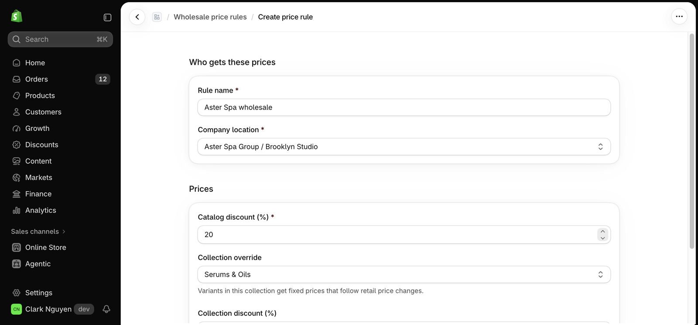
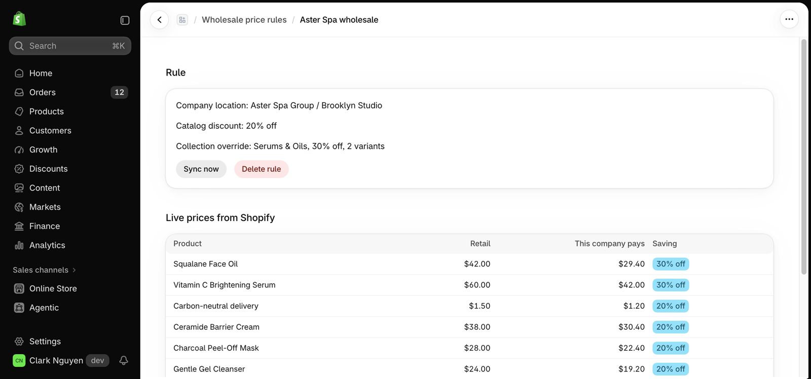
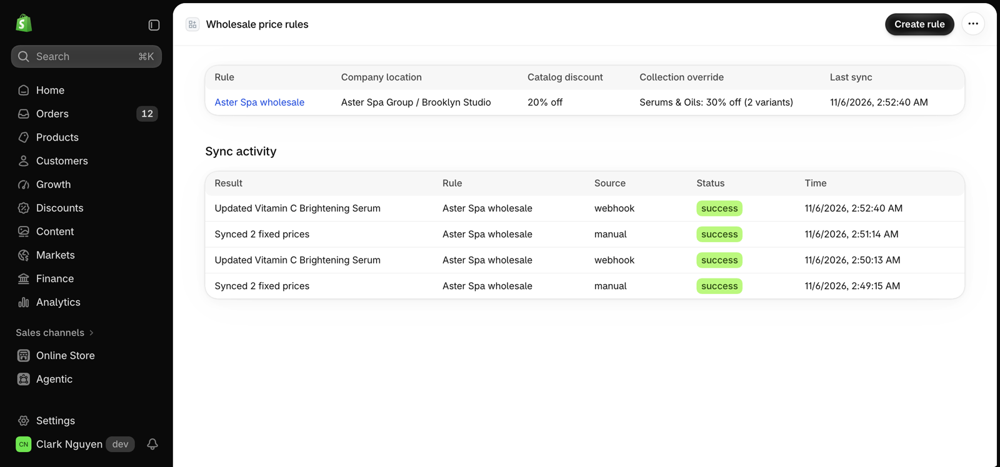

# Clark Catalog Pricing

Demo embedded Shopify app that gives each B2B company location its own catalog and prices. Fictional store and company; numbers are test data.

Built with React Router (the successor to Remix in Shopify's template), Prisma, Polaris web components and Admin GraphQL `2026-10`.

## What it does

- Creates a Shopify catalog and price list for a company location, with a percentage discount.
- Adds a collection override: fixed prices for one collection, written in batches of 250.
- Listens to `products/update`, so a retail price change updates the fixed price.
- Shows live prices from `contextualPricing`, and a sync log.
- Keeps every rule and log scoped to the shop.

## Screenshots

| Create a rule | Company prices |
|---|---|
|  |  |

| After a retail change: $48 to $60 gives $42 | Sync activity |
|---|---|
|  |  |

## Run it

```bash
npm install
npm run setup
shopify app dev --store <your-dev-store>.myshopify.com
```

Needs a Plus dev store with at least one B2B company. Scopes: `write_products`, `read_companies`.

## Checks

```bash
npm test
npm run typecheck
npm run lint
```

## Limits of this demo

- Runs through `shopify app dev`; it is not hosted.
- SQLite is for local use. Production needs a hosted database.
- The webhook updates prices in the request. A large catalog needs a queue.
- A product removed from the override collection keeps its fixed price until it is cleared.
- One rule per company location. Prices use the shop currency only.
